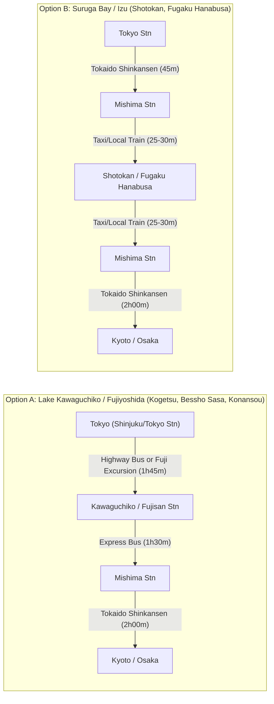

# Verified Mt. Fuji Private Onsen Ryokan Guide (May 2027)
**Group Profile:** 6 Adults (3 Couples / 3 Rooms) | **Stay:** 1 Night, Mid-Week (May 15–30, 2027)  
**Target Budget:** ¥70,000 – ¥180,000 ($450 – $1,200 USD) per room/night (includes multi-course *Kaiseki* dinner & breakfast for 2)  
**Bedding Requirement:** 1 Room with Western Beds + 2 Rooms with Tatami/Futons (or hybrid *Wa-yōshitsu*)

---

## 1. The "Listicle Traps" We Eliminated First

Cross-referencing official Japanese room specifications (`客室詳細`) and domestic bath disclosures (`温泉表記`) immediately disqualified several of the internet's most heavily promoted properties:

> [!WARNING]
> **Famous Properties Disqualified by Official Japanese Specs**
> * **Kozantei Ubuya (湖山亭うぶや — Lake Kawaguchiko):** Promoted on almost every English blog. While the view is incredible, official specs confirm **all 20 private in-room open-air baths are heated tap/spring water (`沸かし湯`)—NOT natural onsen** (only the communal bath uses onsen water). ([YouTube Stay Walkthrough](https://www.youtube.com/watch?v=3Qhk74tJCRo) if you still want to see it).
> * **Hotel Green Plaza Hakone (ホテルグリーンプラザ箱根) & Hakone Ashinoko Hanaori (はなをり):** In-room open-air baths are **heated tap water (`沸かし湯`)**, dining is a noisy buffet hall, and *Hanaori* does not even see Mt. Fuji from the rooms.
> * **Wakakusa no Yado Maruei (若草の宿 丸栄) & La Vista Fuji Kawaguchiko:** In-room open-air baths are **heated tap water (`沸かし湯`)**; Maruei's open-air bath rooms face the lake, facing *away* from Mt. Fuji.
> * **Hoshinoya Fuji (星のや富士), Sanyoso (三養荘), Musouan Biwa (無雙庵 枇杷), Gora Kadan (強羅花壇):** Either lack private in-room onsen baths (*Hoshinoya Fuji*) or have **zero view of Mt. Fuji** from the rooms/baths (*Sanyoso*, *Musouan Biwa*, *Gora Kadan*).
> * **Fufu Kawaguchiko (ふふ河口湖) & THE KUKUNA (風のテラスKUKUNA):** Both have real natural onsen in the rooms, **but 100% of their open-air onsen rooms are Western Twin Beds only** (no tatami/futon option in the onsen rooms), and lower-floor rooms at *Fufu* have forest foliage blocking the base of Mt. Fuji.

---

## 2. Executive Comparison Matrix: Top 6 Verified Finalists

Every finalist below has been verified on its official Japanese site and **Ikkyu.com (一休.com)** to confirm:
1. **100% Real Natural Onsen (`天然温泉`)** piped directly into the private room/balcony open-air bath.
2. **Unobstructed Mt. Fuji Views** directly from the room and private bath.
3. **$\ge 3$ Qualifying Rooms** with a mix of **Western Beds** and **Tatami/Futons**.
4. **Private Group Dining (`個室食事処` / `料亭個室`)** capable of seating all 6 adults together.

| # | Ryokan Name (JP / EN) | Region & View Setting | Qualifying Fuji-View Onsen Rooms | Private Bath Water Type | 6-Person Private Dining | Domestic Ratings (Ikkyu / Rakuten / Google) | Price / Room (2 Pax w/ 2 Meals) | Booking Window (May 2027) |
| :- | :--- | :--- | :--- | :--- | :--- | :--- | :--- | :--- |
| **1** | **秀峰閣 湖月** *(Shuhokaku Kogetsu)* | **Kawaguchiko North Shore** *(Fuji over Lake)* | **8** Open-Air Onsen rooms (+ 5 Footbath Onsen rooms) | **100% Real Natural Onsen** (`天然温泉`) | **Yes** (`個室食事処` / Private Banquet) | Ikkyu: **4.79** Rakuten: **4.75** Google: **4.6** | ¥85,000 – ¥145,000 | **3–4 mos ahead** *(Jan/Feb 2027)* |
| **2** | **伊豆・三津浜温泉 松濤館** *(Shotokan)* | **Suruga Bay / Mito (Izu)** *(Fuji over Ocean)* | **15** Semi-Open-Air Onsen rooms (All 21 face Fuji) | **100% Real Natural Onsen** (`天然温泉`) | **Yes** (`料亭個室` / Private Dining Room) | Ikkyu: **4.71** Rakuten: **4.68** Google: **4.5** | ¥88,000 – ¥145,000 | **6 mos ahead** *(Nov 2026)* |
| **3** | **富士山温泉 別墅然然** *(Kaneyamaen Bessho Sasa)* | **Fujiyoshida Foothills** *(Fuji over Gardens)* | **17** Suites in *Sasa* (+ 20+ in *Sanri / Yuraku*) | **100% Real Natural Onsen** *(pH 10.3 Alkaline)* | **Yes** *(Must request $\ge 3$ days prior)* | Ikkyu: **4.72** Rakuten: **4.70** Google: **4.6** | ¥105,000 – ¥175,000 | **6 mos online** **1 yr by phone** |
| **4** | **富士河口湖温泉 湖南荘** *(Konansou)* | **Kawaguchiko Central** *(Fuji over Town/Foothills)* | **~11** Mt. Fuji-side Open-Air Onsen rooms | **100% Real Natural Onsen** (`天然温泉`) | **Yes** (`料亭個室` / Private Dining Room) | Ikkyu: **4.57** Rakuten: **4.70** Google: **4.5** | ¥80,000 – ¥140,000 | **5–6 mos ahead** *(Nov/Dec 2026)* |
| **5** | **伊豆長岡温泉 富嶽はなぶさ** *(Fugaku Hanabusa)* | **Central Izu (Kano River)** *(Fuji over River)* | **6+** Open-Air / Semi-Open-Air Onsen rooms | **100% Free-Flowing Onsen** (`源泉かけ流し`) | **Yes** (`完全個室` / 100% Private Rooms) | Ikkyu: **4.69** Rakuten: **4.64** Google: **4.2** | ¥72,000 – ¥125,000 | **6 mos ahead** *(Nov 2026)* |
| **6** | **世界遺産 富士山を望む宿 富岳群青** *(Fugaku Gunjo)* | **West Izu Clifftop (Toi)** *(Fuji over Ocean)* | **All 8** Detached Luxury Suites (130㎡ each) | **100% Real Natural Onsen** (`土肥温泉`) | **Yes** *(Request combined room at booking)* | Ikkyu: **4.64** Rakuten: **4.54** Google: **4.5** | ¥130,000 – ¥185,000 | **6 mos ahead** *(Nov 2026)* |

*(Bonus Hakone Option: **箱根湯宿 然 -ZEN-** has exactly 3 Fuji-view rooms with 100% free-flowing milky Owakudani sulfur onsen—detailed in Section 3.7 below.)*

---

## 3. Deep-Dive Profiles, Exact Room Names to Book & YouTube Walkthroughs

### 3.1. 秀峰閣 湖月 (Shuhokaku Kogetsu) — *Best Classic Lake + Mt. Fuji Postcard View*
* **Official Website:** [kogetu.com](https://www.kogetu.com/)
* **The Sightline:** Located on the far northern shore of Lake Kawaguchiko. Unlike properties near the station, there are **zero power lines, buildings, or roads** between the ryokan and the water—just the manicured lawn, Lake Kawaguchiko, and Mt. Fuji dead-center from every room and balcony tub.
* **Exact Room Combination to Book for 3 Couples:**
  * **For the 1 Couple Wanting Western Beds:** Book 1 of the **4 Renovated 3rd-Floor Open-Air Onsen Rooms** (`3階 露天風呂付 コーナーテラスツイン` [Corner Terrace Twin], `露天風呂付 洋室ツイン` [Western Twin], or `露天風呂付 和モダントリプル`) **OR** the 2nd-floor `露天風呂付 和洋特別室` (Tatami + Twin Beds).
  * **For the 2 Couples Wanting Futons:** Book 2 of the **2nd-Floor Open-Air Onsen Japanese Rooms** (`2階 露天風呂付客室 和室12畳＋土間リビング＋露天風呂・足湯付`). *(Backup option if 2F open-air rooms sell out: the 5 `2階 足湯付客室` have a balcony onsen footbath + indoor view bath).*
* **Bath Water:** 100% real Kawaguchiko natural onsen (`天然温泉`) in all 8 open-air bath rooms (outdoor lava rock & cypress tubs on the private terrace).
* **Group Dining:** When you link 3 room reservations, the ryokan assigns a private dining room (`個室食事処` or small private banquet room) so all 6 of you eat your Yamanashi Koshu beef & seasonal *Kaiseki* dinner together.
* **Local Japanese Review Insights (Ikkyu 4.79):** Highest-rated traditional ryokan on Lake Kawaguchiko. Reviewers love the complimentary afternoon draft beer and local Yamanashi wine lounge overlooking the lake, the piano performances, and the dead-center reflection of Mt. Fuji (`逆さ富士`). The only complaint is how fast the 8 open-air bath rooms sell out.
* **Transit Route (Tokyo $\leftrightarrow$ Kyoto):**
  * *From Tokyo:* Direct Highway Bus from Shinjuku/Tokyo Station to Kawaguchiko Station (~1 hr 45 min) or Limited Express *Fuji Excursion* train, then ryokan shuttle.
  * *To Kyoto:* Express Bus from Kawaguchiko Station to **Mishima Station** (~1 hr 30 min), then hop directly onto the Tokaido Shinkansen to Kyoto (~2 hrs).
* **Authentic YouTube Stay Walkthrough (`宿泊記`):**
  * [Shuhokaku Kogetsu — 3F Corner Terrace Open-Air Onsen Room, Lounge & Kaiseki Dinner Walkthrough](https://www.youtube.com/watch?v=T-8fEZDZSPw)

---

### 3.2. 伊豆・三津浜温泉 松濤館 (Izu Mitsuhama Onsen Shotokan) — *Best Shinkansen Access + Over-Ocean Mt. Fuji View*
* **Official Website:** [shoutoukan.com](https://www.shoutoukan.com/)
* **The Sightline:** Built right at the water's edge of Mito Bay on the Izu Peninsula. All 21 rooms look directly across the calm blue waters of Suruga Bay and Awashima Island to a massive, unobstructed view of Mt. Fuji rising behind the coastline.
* **Exact Room Combination to Book for 3 Couples (15 Qualifying Rooms on Floors 3–5):**
  * **For the 1 Couple Wanting Western Beds:** Book **`半露天風呂付和洋室「花・海」` (Japanese-Western Suite "Hana / Umi" — 63㎡, 6 rooms available)** which has a 12-mat tatami living space + a separate hardwood bedroom with Simmons twin beds, OR **`半露天風呂付特別室「月」` (Corner Suite "Tsuki" — 90㎡, 3 rooms available)**.
  * **For the 2 Couples Wanting Futons:** Book 2 rooms of **`半露天風呂付和室12畳「見」` ("Mi" — 63㎡, 3 rooms)** or **`半露天風呂付和室10畳「風」` ("Kaze" — 50㎡, 3 rooms)**, which are pure traditional tatami rooms with futons.
  * *Bonus:* Because Floors 3, 4, and 5 each have an identical layout (`月`, `花`, `海`, `見`, `風`), you can even book **all 3 couples on the exact same floor**!
* **Bath Water:** 100% real natural onsen (blend of Mitsuhama Onsen & Ohito Onsen) in every room's cypress/stone semi-open-air bath (`半露天風呂`), with sliding wide-open glass/screen windows to let the ocean breeze in while gazing at Mt. Fuji.
* **Group Dining:** Served in their traditional *Ryotei* private dining rooms (`料亭個室食事処`), which easily seat all 6 adults together for Suruga Bay seafood & Izu Wagyu *Kaiseki*.
* **Local Japanese Review Insights (Ikkyu 4.71):** Praised by Japanese travelers for spotless floor-to-ceiling windows, refined service, and top-tier sashimi/seafood (Suruga Bay is the deepest bay in Japan). Minor note: daytime sounds from the nearby Mito Sea Paradise aquarium can occasionally be heard on the deck during the afternoon.
* **Transit Route (Super Easy Shinkansen Stopover):**
  * Take the Tokaido Shinkansen (from either Tokyo or Kyoto) to **Mishima Station**. From Mishima, take the Izuhakone Railway to Izu-Mito Station (~25 min + free shuttle) or a single 30-minute taxi straight from the Shinkansen station (split 3 ways, a taxi/van is very fast and cheap).
* **Authentic YouTube Stay Walkthroughs (`宿泊記`):**
  * [Shotokan — Special Suite "Tsuki" (月) Room, Onsen Bath & Kaiseki Walkthrough](https://www.youtube.com/watch?v=41u0FQKJxh0)
  * [Shotokan — Full Property & Mt. Fuji Over-Ocean Bath Views](https://www.youtube.com/watch?v=bfQTkq9TtZU)

---

### 3.3. 富士山温泉 ホテル鐘山苑 別墅然然 (Hotel Kaneyamaen / Bessho Sasa) — *Best Luxury Amenities, Silky pH 10.3 Onsen & Easiest Room Inventory*
* **Official Websites:** [bessho-sasa.com](https://www.bessho-sasa.com/) (Club Floors) | [kaneyamaen.com](https://www.kaneyamaen.com/) (Main Property)
* **The Sightline:** Located in Fujiyoshida (~15 minutes from Lake Kawaguchiko). Instead of looking across a lake, you look over a vast 20,000-*tsubo* traditional Japanese garden straight at Mt. Fuji's sweeping lower slopes all the way to the summit (`裾野まで広がる富士山`).
* **Exact Room Combination to Book for 3 Couples:**
  * *Bessho Sasa* comprises the dedicated luxury club floors (4F & 5F) with **17 suites—all 17 have private natural onsen open-air baths with direct, head-on Mt. Fuji views**:
    * **Option A (All 3 Couples in *Bessho Sasa*):** Book 1 **`瑞穂 (Mizuho)` (60㎡, 9 rooms — Western Twin beds)** + 2 **`福地 (Fukuchi)` (67–85㎡, 6 rooms — *Wa-yōshitsu* with both 2 Simmons beds AND a tatami room for up to 3 futons)**.
    * **Option B (Pure Tatami Option in *Yuraku Yamabiko-tei*):** If 2 couples want pure traditional tatami without beds in the room, book **`ゆらく山彦亭 (Yuraku Yamabiko-tei)` — `話楽 (Waraku)` or `湯話 (Yubanashi)`** (12.5-mat tatami + Airweave futons + Mt. Fuji open-air onsen bath; *avoid `野楽 Noraku` as it faces an inner courtyard*).
* **Bath Water:** 100% real natural Fujisan Onsen (`天然温泉・源泉`) with an extraordinary **pH of 10.3** (one of the highest alkaline "silky skin" waters in Japan). Plus, you get access to Kaneyamaen's famous 10th-floor tiered infinity rooftop *rotenburo* facing Mt. Fuji.
* **Group Dining Rule (Important):** Normally, *Bessho Sasa* serves meals inside each suite's private dining room (which seats up to 5). However, per official policy, **if you request at least 3 days in advance**, a group of 6 adults across 3 rooms will be given a dedicated **private dining room (`個室料亭`)** so all 6 of you dine together.
* **Local Japanese Review Insights (Ikkyu 4.72):** Guests rave about the private *Sasa Lounge* (complimentary Yamanashi wine, beer, coffee, and sweets), the strolling garden with free matcha tea ceremony, and the nightly *Taiko* drum show in the main lobby.
* **Booking Advantage:** Opens **6 months in advance online** (November 2026) and **1 full year in advance by phone**—making it the safest bet to lock in 3 top-tier rooms simultaneously.
* **Authentic YouTube Stay Walkthroughs (`宿泊記`):**
  * [Bessho Sasa — "Fukuchi" (福地) Wa-yōshitsu Suite & Mt. Fuji Open-Air Bath Review](https://www.youtube.com/watch?v=pzSEGRR_I7I)
  * [Bessho Sasa — Full Walkthrough of Club Lounge, Room, Onsen & Kaiseki](https://www.youtube.com/watch?v=J1RyQeCdTks)

---

### 3.4. 富士河口湖温泉 湖南荘 (Konansou) — *Best Walkable Kawaguchiko Option with True Tatami + Bed Room Mix*
* **Official Website:** [konansou.com](https://www.konansou.com/)
* **The Sightline:** Located in the central/southeastern shore area of Kawaguchiko (a 10-minute walk or 2-minute shuttle from Kawaguchiko Station).
  * **Crucial Booking Rule:** Konansou has two sides: **Lake-side (`河口湖側`)** and **Mt. Fuji-side (`富士山側`)**. You must book **Mt. Fuji-side (`富士山側`)** rooms! (Avoid the modern rooms *Rin* and *Kohaku*, which face the lake). From the Mt. Fuji-side rooms, Mt. Fuji towers directly in front of your balcony open-air bath, and you can also visit the 360-degree rooftop footbath deck (`屋上展望足湯`) to see both the lake and Mt. Fuji together.
* **Exact Room Combination to Book for 3 Couples (~11 Qualifying Fuji-Side Onsen Rooms):**
  * **For the 1 Couple Wanting Western Beds:** Book **`【富士山側】露天風呂付和洋特別室 [Type D (80㎡) or Type E DX (102㎡)]`** (features Simmons Twin beds + 12.5 or 17.5-mat tatami living space + private natural onsen bath facing Mt. Fuji).
  * **For the 2 Couples Wanting Futons:** Book 2 rooms of **`【富士山側】露天風呂付和室 (12.5畳 [60㎡] or 12畳 [47㎡])`** (pure traditional tatami rooms with futons and wooden open-air onsen baths facing Mt. Fuji).
* **Bath Water:** 100% real Kawaguchiko natural onsen (`天然温泉`) piped into all open-air bath rooms.
* **Group Dining:** Features dedicated private *Ryotei* dining rooms (`料亭個室`) specifically built for multi-room family and group *Kaiseki* dinners.
* **Local Japanese Review Insights (Rakuten 4.70 / Ikkyu 4.57):** Praised for huge room proportions, classic ryokan comfort, and the iconic rooftop footbath. Criticisms note that because it's near the station, the lobby can feel bustling and the foreground view below Mt. Fuji includes town rooftops rather than water.
* **Authentic YouTube Stay Walkthroughs (`宿泊記`):**
  * [Konansou — Mt. Fuji-Side Open-Air Onsen Room & Rooftop Footbath Tour](https://www.youtube.com/watch?v=zPdK5KWJ878)
  * [Konansou — Open-Air Onsen Bath & Group Dining Stay Vlog](https://www.youtube.com/watch?v=78P5rclOeV0)

---

### 3.5. 伊豆長岡温泉 富嶽はなぶさ (Fugaku Hanabusa) — *Best Value for 100% Free-Flowing Onsen (`源泉かけ流し`) & Culinary Focus*
* **Official Website:** [yadohanabusa.com](https://yadohanabusa.com/)
* **The Sightline:** Located along the quiet Kano River in Izunagaoka Onsen (~25 minutes from Mishima Shinkansen Station). All 24 rooms face north down the river corridor toward Mt. Fuji.
* **Exact Room Combination to Book for 3 Couples:**
  * **Western Beds:** **`ラグジュアリーツイン露天風呂付き客室` (Luxury Twin Open-Air Bath Room — 2 rooms)** or **`エグゼクティブ半露天風呂付き客室` (Executive Semi-Open-Air Bath Suite — 60㎡, renovated Feb 2025)**.
  * **Tatami/Futons + Low Beds:** **`デラックス露天風呂付き客室` (Deluxe Open-Air Bath Wa-yōshitsu — 77㎡, 2 rooms with 14-mat tatami + twin beds)** or **`スーペリア露天風呂付き客室` (46㎡)**.
* **Bath Water:** **100% pure free-flowing spring source water (`天然温泉100% 源泉かけ流し`)** in the room baths—meaning the volcanic spring water is not recirculated or chlorinated, offering the purest onsen soak on this list. Guests also get complimentary use of 3 reservable private open-air baths (`貸切露天風呂`).
* **Group Dining:** 100% of dinners and breakfasts are served in **completely private dining rooms (`完全個室食事処`)**, easily seating all 6 adults together. The young 3rd-generation chef is famous across domestic media for Shizuoka A5 Wagyu *aburi* sushi/steak and braised *Kinmedai* (golden eye snapper).
* **Local Japanese Review Insights (Ikkyu 4.69):** Beloved by Japanese foodies and hot-spring purists for the water quality and cuisine. Note that Mt. Fuji appears further in the distance framed by the river valley compared to Kawaguchiko, and the building exterior has older retro bones despite crisp modern room renovations.
* **Authentic YouTube Stay Walkthroughs (`宿泊記`):**
  * [Fugaku Hanabusa — Renovated 46㎡ Mt. Fuji Open-Air Onsen Room Tour](https://www.youtube.com/watch?v=qZ-a_g7atDs)
  * [Fugaku Hanabusa — Guest Stay Vlog, Free-Flowing Bath & Kaiseki](https://www.youtube.com/watch?v=A3b9SQAidmk)

---

### 3.6. 世界遺産 富士山を望む宿 富岳群青 (Fugaku Gunjo) — *Best Ultra-Luxury Boutique (8 Clifftop Suites, 1 Michelin Key)*
* **Official Website:** [fugakugunjo.jp](https://www.fugakugunjo.jp/)
* **The Sightline:** High on a coastal ridge in Toi (West Izu), overlooking the deep blue expanse of Suruga Bay with a dramatic, uninterrupted panorama of Mt. Fuji over the ocean. The entire property consists of only **8 detached-style luxury suites (130㎡ each)** connected by water-garden walkways.
* **Exact Room Combination to Book for 3 Couples:**
  * **All 8 suites qualify** (`虹の端`, `雲引き`, `潮満つ`, `山の音`, `海の丘`, `波の風`, `沖の嶺`, `月待つ`).
  * Every single 130㎡ suite is a **Japanese-Western Suite (`和洋室`)** featuring custom **Nihon Bed** twin beds **PLUS** an adjacent tatami room where the staff can lay out **traditional Japanese futons** for the couples who prefer futons.
* **Bath Water:** Real natural Toi Onsen (`土肥温泉`) in every suite's massive wooden deck open-air bath overlooking the ocean and Mt. Fuji.
* **Group Dining:** Serves "Izu French Kaiseki" (French-influenced seasonal Izu seafood & Wagyu eaten with chopsticks) in private dining rooms. Request a combined 6-person private room at the time of booking.
* **Local Japanese Review Insights (Ikkyu 4.64 / 1 Michelin Key):** Unmatched exclusivity and architecture; each suite's deck feels suspended over the ocean and Mt. Fuji. Sits at the top edge of your budget (~¥130,000–¥180,000/room mid-week) and requires a ~50-minute taxi/bus from Shuzenji Station (or taking the scenic 70-minute Suruga Bay Ferry across the water with Mt. Fuji views!).
* **Authentic YouTube Stay Walkthroughs (`宿泊記`):**
  * [Fugaku Gunjo — Guest Stay Vlog, 130㎡ Suite, Open-Air Bath & French Kaiseki](https://www.youtube.com/watch?v=WuOpvRMBfQ4)
  * [Fugaku Gunjo — Detailed Room & Over-Ocean Mt. Fuji Bath Tour](https://www.youtube.com/watch?v=QoDblR6KOJE)

---

### 3.7. Bonus Option If You Specifically Want Hakone: 箱根湯宿 然 -ZEN- (Hakone Yuyado Zen)
* **Official Website:** [hakone-zen.com](https://www.hakone-zen.com/)
* **Why It's Unique:** Almost no luxury ryokans in Hakone can see Mt. Fuji from the rooms. Perched on a high ridge in Sengokuhara, **Hakone Yuyado Zen** has **3 specific rooms** that look over the Hakone outer rim directly at the upper peak of Mt. Fuji:
  1. **`【しろ - Shiro】` (3F Japanese-Western Room):** Twin beds + Tatami room (futons available) + Fuji-view cypress bath.
  2. **`【つるばみ - Tsurubami】` (3F Western Twin Room):** Twin beds + Fuji-view cypress bath.
  3. **`【しろがね - Shirogane】` (2F Western Twin Room):** Twin beds + Fuji-view cypress bath.
  *(Note: If 2 couples want tatami, you can swap one twin room for `【こはく - Kohaku】`, which has tatami + beds facing the Hakone Outer Rim ridge right next to the Fuji rooms).*
* **Bath Water:** **100% Free-Flowing Milky Sulfur Water from Owakudani (`大涌谷温泉 源泉かけ流し・にごり湯`)** in every room's cypress semi-open-air bath.
* **Ratings & Price:** Ikkyu **4.75** / Rakuten **4.65** | ~¥90,000 – ¥135,000 per room/night | Opens **6 months ahead**.
* **Authentic YouTube Stay Walkthroughs (`宿泊記`):**
  * [Hakone Yuyado Zen — Milky Onsen Bath, Mt. Fuji View & Kaiseki Vlog](https://www.youtube.com/watch?v=yPOOJBzv334)
  * [Hakone Yuyado Zen — Room & Dining Walkthrough](https://www.youtube.com/watch?v=sFYFt-CksqM)

---

## 4. Transit & Routing Comparison (Tokyo $\leftrightarrow$ Ryokan $\leftrightarrow$ Kyoto)

* **Outbound vs. Return Stopover:** Either direction works equally well! Doing the ryokan on the **return leg (Kyoto $\rightarrow$ Ryokan $\rightarrow$ Tokyo)** is often a favorite for groups because after a week of walking 20,000+ steps a day in Kyoto and Osaka, soaking in a private Mt. Fuji hot spring with a *Kaiseki* feast feels incredible—and you can forward your heavy suitcases directly from Kyoto to your final Tokyo hotel via *Takkyubin* (luggage delivery), bringing only an overnight backpack to the ryokan.

---

## 5. Action Timeline for May 15–30, 2027

Because you need **3 qualifying rooms on the exact same night**, booking the week reservations open is crucial:
1. **Early November 2026 (6 Months Out — Coming Up Soon!):**
   * Reservations open for **Shotokan (松濤館)**, **Hotel Kaneyamaen / Bessho Sasa (別墅然然)** *(or call now, up to 1 year out)*, **Konansou (湖南荘)**, **Fugaku Hanabusa (富嶽はなぶさ)**, **Fugaku Gunjo (富岳群青)**, and **Hakone Yuyado Zen (然)**.
2. **January / February 1, 2027 (3–4 Months Out):**
   * Reservations open for **Shuhokaku Kogetsu (秀峰閣 湖月)**.
3. **At the Time of Booking:**
   * Put in the reservation notes (in Japanese—I can draft the exact message for you once you pick a property): *"We are 6 adults staying across 3 rooms (Reservation #A, #B, #C) and would like to request a private dining room (`個室食事処`) where all 6 of us can dine together for dinner and breakfast."*
